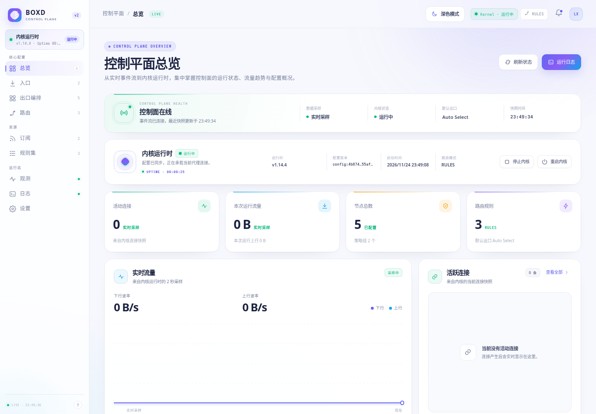
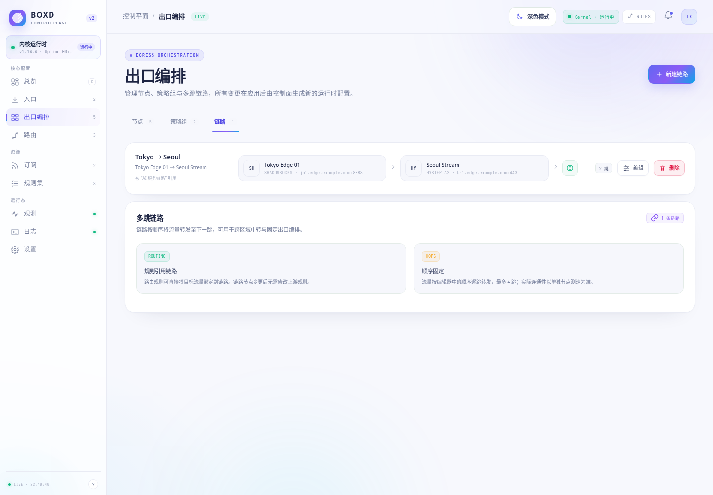
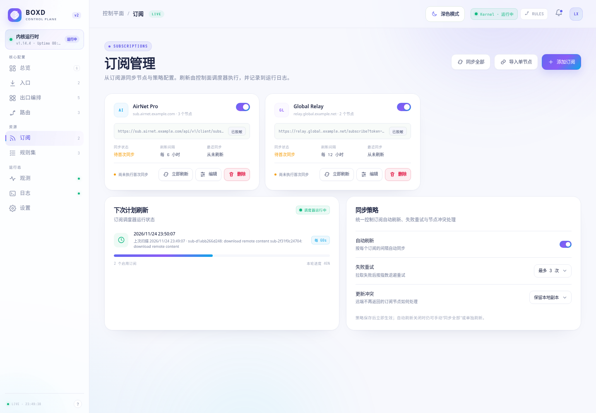
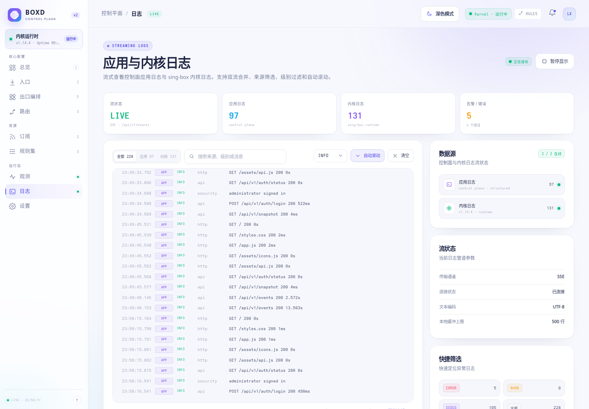
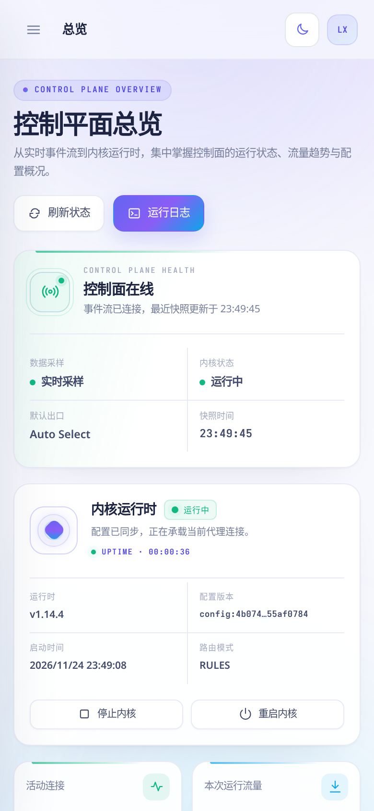
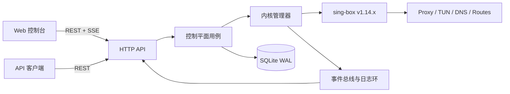

<p align="center">
  
</p>

<h1 align="center">boxd</h1>

<p align="center">
  基于 sing-box 的现代化控制平面，内置 Web 控制台、订阅管理、策略路由、DNS 编排与流式可观测能力。
</p>

<p align="center">
  <a href="https://github.com/xuthus5/boxd/actions/workflows/ci.yml"></a>
  <a href="https://github.com/xuthus5/boxd/releases"></a>
  <a href="LICENSE"></a>
  <a href="https://github.com/xuthus5/boxd/pkgs/container/boxd"></a>
</p>

<p align="center">
  <a href="#项目简介">项目简介</a> ·
  <a href="#产品截图">产品截图</a> ·
  <a href="#架构设计">架构设计</a> ·
  <a href="#部署方式一二进制部署">二进制部署</a> ·
  <a href="#部署方式二systemd-部署">systemd 部署</a> ·
  <a href="#部署方式三容器化部署">容器化部署</a> ·
  <a href="#rest-api-与事件流">API</a> ·
  <a href="#开发与测试">开发与测试</a>
</p>

> **项目状态**：当前版本聚焦控制平面、数据平面及其管理能力，不包含桌面/移动宿主接入、Web Shell、终端执行和备份恢复功能。

> **商用发布基线**：当前 Web 控制台、控制平面、持久化、内核驱动和 API 均连接真实 `boxd` 实例，不包含前端 mock 数据。仓库已提供许可证、OpenAPI 契约、跨浏览器 E2E、无障碍门禁、兼容性矩阵、安全政策和发布检查清单。正式对外提供服务前，部署方仍应完成自身环境的安全审计、容量验证、合规评估和运维预案。

## 项目简介

boxd 是一个围绕 [sing-box](https://sing-box.sagernet.org/) 构建的代理控制平面。它把内核生命周期、配置事务、入站监听、节点与订阅、策略组、多跳链路、路由规则、DNS、规则集和运行观测统一到一个可审计、可回滚的管理模型中，并通过内置 Web 控制台和 REST/SSE API 对外提供操作能力。

项目采用清晰的分层边界：

- `cmd/boxd` 只负责宿主启动与参数解析。
- `control`、`kernel` 是不依赖内部实现细节的稳定契约。
- `internal/controlplane` 实现控制面用例和统一配置事务。
- SQLite、sing-box、HTTP/订阅下载器等外部依赖被隔离在各自适配器中。
- 生产构建通过 Go embed 内嵌 Web 控制台，无需额外部署静态文件。

当前版本适合单机部署代理控制面、节点编排和本地 Web 管理；远程访问应通过可信网络或 TLS 反向代理完成。

## 产品截图

以下截图来自隔离的演示实例，订阅、节点和域名为示例数据。

### 控制平面总览

总览页按运行优先级组织信息，集中展示 SSE 连接状态、内核运行时、实时流量采样、节点与路由规模、订阅健康和活动连接。



### 出口编排与策略路由

出口编排支持节点、Selector/URLTest 策略组和最多 4 跳代理链路；链路可直接被路由规则引用，并在变更后统一生成新的运行时配置。

| 多跳链路编排 | 订阅资源管理 |
|---|---|
|  |  |

### 流式日志与移动端

应用日志与 sing-box 内核日志共用同一 SSE 日志管道，支持来源、级别、关键词筛选、暂停显示和自动滚动。Web 控制台同时适配桌面与移动设备。

| 应用与内核日志 | 移动端总览 |
|---|---|
|  |  |

## 核心能力

| 领域 | 能力 |
|---|---|
| 内核生命周期 | `Start`、`Stop`、`Restart`、`ApplyConfig`；单写入者状态机；原子配置持久化；应用失败自动回滚 |
| 入站管理 | Mixed 双栈监听、TUN 入口、UDP 开关、认证、入口级出口绑定 |
| 出口编排 | 单节点、Selector 策略组、URLTest 策略组、最多 4 跳代理链路 |
| 路由与 DNS | `rules` / `global` / `direct` 模式，常用预设，有序规则；国内 / 国外 / 默认 DNS 槽位，支持 UDP、DoH、DoT |
| 订阅与节点 | sing-box JSON、Base64 JSON、分享链接列表、Base64 链接列表；条件刷新、定时同步、稳定节点 ID、冲突策略 |
| 节点操作 | 单节点编辑、单节点/多节点测速、URL Test、TCP Ping、ICMP Ping、测速历史 |
| 规则集 | 内置与自定义规则集、条件下载、字节统计、刷新状态和依赖校验 |
| 可观测性 | 真实连接快照、连接关闭、流量采样、DNS 探测、规则命中、应用与内核日志流 |
| 安全 | 本地管理员 PBKDF2 口令、24 小时会话、HttpOnly + SameSite=Strict Cookie、Bearer Token、同源写操作校验 |
| 数据存储 | SQLite WAL、外键、版本化内嵌迁移、配置历史和期望状态快照 |

## 商用发布与质量治理

boxd 以“可部署、可验证、可维护”为发布基线，而不是只有界面原型的演示项目。每次变更需要同时通过 Go 单元/竞态测试、JavaScript/CSS 静态检查、OpenAPI 路由契约校验，以及真实二进制启动后的 Playwright 端到端测试。

| 发布门禁 | 覆盖内容 |
|---|---|
| Go 质量门禁 | `gofmt`、`go vet`、单元测试、竞态测试、`govulncheck` 可达漏洞扫描和全量构建 |
| API 契约 | OpenAPI 3.1 规范；CI 校验全部 Go 路由、Schema 引用、`operationId` 和响应定义 |
| 浏览器 E2E | Chromium、Firefox、WebKit 桌面端与 Chromium 移动端；登录、导航、内核生命周期、订阅 CRUD、单节点导入、主题与响应式布局 |
| 无障碍 | axe-core WCAG 2.1 A/AA 扫描；禁止 serious/critical 违规，并检查键盘可访问的日志滚动区 |
| 发布治理 | Apache-2.0、变更日志、安全政策、兼容性矩阵、发布检查清单、本地文档链接校验、校验和与 GHCR 多架构镜像 |

详细的支持边界见 [兼容性矩阵](docs/compatibility.md)，发布前步骤见 [发布检查清单](docs/release-checklist.md)。当前版本仍是单机单管理员控制面，不等同于多租户授权边界。

## 架构设计



依赖方向为 `cmd -> bootstrap -> controlplane / adapters / manager -> kernel`。公开契约不依赖 `internal`，sing-box 与 SQLite 驱动分别限制在各自适配器内。

### 目录结构

```text
cmd/boxd/                          headless / Web 宿主入口
control/                           稳定控制面契约
kernel/                            稳定内核契约
prototype/                         内嵌 Web 控制台静态资源
webfiles.go                        Web 资源 embed 入口
internal/bootstrap/                唯一组合根
internal/controlplane/             控制面用例与配置事务
internal/kernel/manager/           与引擎无关的内核状态机
internal/adapters/inbound/httpapi/ REST、SSE、认证和静态控制台
internal/adapters/outbound/        sing-box 配置、SQLite、订阅、下载和探测适配器
internal/driver/singbox/           sing-box 唯一依赖边界与真实 Driver
deploy/                            systemd 单元、安装与卸载脚本
docs/                              架构、控制面和版本兼容文档
.github/workflows/                 CI、Release、Nightly 与容器发布
```

更完整的领域约束、API 与应用语义见 [控制面文档](docs/control-plane.md)，设计背景见 [V2 设计文档](docs/superpowers/specs/2026-11-21-boxd-v2-design.md)。

## 环境要求

- Linux `amd64` 或 `arm64`。
- 默认 Web 监听端口 `7662`，Mixed 代理监听端口 `1080`。
- 二进制发布包为静态构建，不依赖系统 Go 环境。
- 从源码构建需要 Go `1.27+`。
- 使用 TUN 时需要 `/dev/net/tun` 和 `CAP_NET_ADMIN`；容器场景通常还需要 host 网络。
- 使用 systemd 部署时要求目标主机由 systemd 管理。

生产构建必须包含 `with_utls,with_quic` 构建标签。`with_utls` 用于 VLESS Reality 等依赖 uTLS 的节点，`with_quic` 用于 Hysteria2 等 QUIC 协议。

## 部署方式一：二进制部署

二进制部署适合单用户测试、容器外快速验证或由其他进程管理器托管。

### 1. 获取发布包

从 GitHub Release 下载对应架构的二进制和校验文件：

```bash
VERSION=v0.1.0
ARCH=amd64 # arm64 主机改为 arm64
RELEASE_URL="https://github.com/xuthus5/boxd/releases/download/${VERSION}"

curl -fLO "${RELEASE_URL}/boxd-linux-${ARCH}"
curl -fLO "${RELEASE_URL}/checksums.txt"
grep " boxd-linux-${ARCH}$" checksums.txt | sha256sum -c -
chmod +x "boxd-linux-${ARCH}"
```

也可以直接下载完整部署包：

```bash
curl -fLO "${RELEASE_URL}/boxd-linux-${ARCH}.tar.gz"
tar -xzf "boxd-linux-${ARCH}.tar.gz"
```

### 2. 启动服务

```bash
mkdir -p ./boxd-data
./boxd-linux-amd64 \
  -data-dir ./boxd-data \
  -web \
  -listen '[::]:7662' \
  -start
```

访问 `http://127.0.0.1:7662/`。首次访问需要初始化管理员口令；口令以 PBKDF2 摘要保存在本地数据库中。

`./boxd-data` 由当前用户持有，适合快速验证。生产环境应使用下文 systemd 部署，由 systemd 管理专用数据目录与最小权限。

如果希望先进入控制台检查配置，再手动启动内核，可省略 `-start`：

```bash
./boxd-linux-amd64 -data-dir ./boxd-data -web -listen '[::]:7662'
```

### 3. 从源码构建

```bash
git clone ssh://git@github.com/xuthus5/boxd.git
cd boxd
make build
./bin/boxd -version
```

`make build` 默认使用 `with_utls,with_quic`，并将版本、提交和构建时间写入二进制。

## 部署方式二：systemd 部署

systemd 是生产环境的推荐部署方式。发布包提供安装脚本、加固后的单元文件和安全卸载入口。

### 自动安装

```bash
tar -xzf boxd-linux-amd64.tar.gz
cd boxd-*-linux-amd64
sudo ./install.sh
```

安装脚本会：

1. 将 `boxd` 安装到 `/usr/local/bin/boxd`。
2. 创建 `/var/lib/boxd` 数据目录。
3. 安装 `/etc/systemd/system/boxd.service`。
4. 执行 `systemctl enable` 并启动服务。

只安装、不立即启动：

```bash
sudo ./install.sh --no-start
sudo systemctl start boxd
```

### 从源码安装

```bash
make build
sudo ./deploy/install.sh
```

或者手动安装：

```bash
sudo install -m 0755 bin/boxd /usr/local/bin/boxd
sudo install -d -m 0750 /var/lib/boxd
sudo install -m 0644 deploy/boxd.service /etc/systemd/system/boxd.service
sudo systemctl daemon-reload
sudo systemctl enable --now boxd
```

### 运行参数与目录

默认单元执行：

```text
/usr/local/bin/boxd -data-dir /var/lib/boxd -web -listen [::]:7662 -start
```

| 项目 | 默认值 |
|---|---|
| 二进制 | `/usr/local/bin/boxd` |
| 数据目录 | `/var/lib/boxd` |
| 单元文件 | `/etc/systemd/system/boxd.service` |
| Web 控制台 | `http://127.0.0.1:7662/` |
| Mixed 入口 | `[::]:1080` |
| 服务日志 | `journalctl -u boxd` |

如需修改监听地址或启动参数，优先使用 systemd drop-in，而不是直接覆盖安装单元：

```bash
sudo systemctl edit boxd.service
```

```ini
[Service]
ExecStart=
ExecStart=/usr/local/bin/boxd -data-dir /var/lib/boxd -web -listen [::]:7662
```

### 运维命令

```bash
sudo systemctl status boxd
sudo systemctl restart boxd
sudo journalctl -u boxd -f
curl -fsS http://127.0.0.1:7662/api/v1/health
```

升级时重新执行发布包中的 `sudo ./install.sh` 即可。卸载默认保留 `/var/lib/boxd`：

```bash
sudo ./uninstall.sh
```

仅在明确需要删除业务数据时执行：

```bash
sudo ./uninstall.sh --purge
```

## 部署方式三：容器化部署

容器镜像由 GitHub Actions 构建并推送到 GitHub Container Registry：

```text
ghcr.io/xuthus5/boxd
```

镜像仓库名会自动转小写。正式版本发布语义版本标签和稳定版 `latest`；`main` 分支发布 `nightly` 与 `nightly-<commit>`。

```bash
export BOXD_IMAGE=ghcr.io/xuthus5/boxd:latest
docker login ghcr.io
docker pull "$BOXD_IMAGE"
```

### 基础运行

基础镜像同时启动 Web 控制台和 sing-box 内核：

```bash
docker run -d --name boxd --restart unless-stopped \
  -p 7662:7662 \
  -p 1080:1080 \
  -v boxd-data:/var/lib/boxd \
  "$BOXD_IMAGE"
```

健康检查：

```bash
curl -fsS http://127.0.0.1:7662/api/v1/health
```

### 启用 TUN

TUN 需要 host 网络、网络管理能力和 TUN 设备。此模式会直接修改宿主机路由，请仅在明确需要透明代理时使用：

```bash
docker run -d --name boxd --restart unless-stopped \
  --network host \
  --cap-add NET_ADMIN \
  --cap-add NET_RAW \
  --device /dev/net/tun \
  -v boxd-data:/var/lib/boxd \
  "$BOXD_IMAGE"
```

镜像默认以 `root` 运行，这是创建 TUN 和调整系统路由所需。不使用 TUN 时应避免把 `7662` 直接暴露到不可信公网。

### Docker Compose

```yaml
services:
  boxd:
    image: ghcr.io/xuthus5/boxd:latest
    container_name: boxd
    restart: unless-stopped
    ports:
      - "7662:7662"
      - "1080:1080"
    volumes:
      - boxd-data:/var/lib/boxd

volumes:
  boxd-data:
```

启动与查看日志：

```bash
docker compose up -d
docker compose logs -f boxd
```

## 配置说明

boxd 使用命令行参数启动，托管状态由 Web 控制台和 REST API 写入 SQLite；当前版本不读取独立的 YAML 配置文件。

| 参数 | 默认值 | 说明 |
|---|---|---|
| `-data-dir` | 用户配置目录下的 `boxd` | SQLite、内核缓存和应用数据的根目录 |
| `-web` | `false` | 启用 Web 控制台和 HTTP API |
| `-listen` | `[::]:7662` | Web 控制台与 API 监听地址 |
| `-start` | `false` | 初始化后立即启动 sing-box 内核 |
| `-version` | — | 输出构建版本并退出 |

### 数据目录

```text
/var/lib/boxd/
├── boxd.sqlite        控制面业务数据库
├── boxd.sqlite-wal    SQLite WAL
├── boxd.sqlite-shm    SQLite 共享内存文件
└── cache.db           sing-box 内部缓存，不是业务数据源
```

Web 控制台和 API 的配置事实来源是 SQLite。修改端口、入口、节点、策略组、链路、路由、DNS 或规则集后，控制面会统一生成并应用新的 sing-box 配置。

### 首次启动

首次启动会幂等写入以下默认状态：

- 一个启用的 Mixed 入口：`[::]:1080`。
- 一个默认关闭的 TUN 入口。
- `rules` 路由模式，默认出口为直连。
- 国内、国外和默认 DNS 槽位。
- 内置 `geosite-cn`、`geoip-cn` 和广告规则集定义。

默认 `1080` 端口如果已被其他代理软件占用，内核启动会失败。请先释放端口，或在控制台中修改 Mixed 入口端口后再启动内核。

## 安全建议

- 首次部署后立即设置强管理员口令，不要继续使用测试口令。
- Web 控制台默认使用 HTTP。远程访问必须通过 HTTPS 反向代理、VPN 或可信内网。
- 不要把 `7662`、`1080` 或 TUN 管理能力直接暴露到公网。
- 反向代理应指向 `http://127.0.0.1:7662`，并保留 `Host`、`X-Forwarded-*` 与 SSE 所需的流式响应设置。
- systemd 单元已启用 `NoNewPrivileges`、`ProtectSystem=strict`、`ProtectHome`、`RestrictAddressFamilies` 和能力边界；如需调整 TUN 或网络能力，应逐项评估。
- 节点凭据、订阅令牌和连接凭据在列表视图中脱敏；完整协议参数只在管理员显式打开编辑器时加载。
- 当前版本不提供 Web Shell、任意命令执行、桌面宿主接入和备份恢复能力。

## REST API 与事件流

- REST API 前缀：`/api/v1`
- SSE 事件流：`GET /api/v1/events`
- 健康检查：`GET /api/v1/health`
- 认证状态：`GET /api/v1/auth/status`
- 管理员初始化：`POST /api/v1/auth/initialize`
- 管理员登录：`POST /api/v1/auth/login`

除健康检查、认证状态、初始化和登录外，其余 API 均要求有效会话。Web 控制台使用同源 HttpOnly Cookie；自动化客户端可在登录后使用 `Authorization: Bearer <token>`。

完整路由、领域约束和错误语义见 [控制面文档](docs/control-plane.md)；机器可读的 OpenAPI 3.1 契约见 [docs/openapi.yaml](docs/openapi.yaml)。

## 开发与测试

### 本地运行

```bash
make build
./bin/boxd -data-dir ./tmp-data -web -listen '[::]:7662'
```

访问 `http://127.0.0.1:7662/`，首次进入时初始化管理员口令。

### 常用命令

```bash
make test          # go test -tags with_utls,with_quic ./...
make race          # 竞态测试
make vet           # go vet
make fmt-check     # 检查 Go 格式
make ci            # 格式、vet、测试和构建
make engine-version
```

Web 控制台静态资源位于 `prototype/`，通过 `webfiles.go` 与 Go embed 打包，不需要 Node.js 构建步骤。

### 浏览器质量门禁

Playwright 测试会构建并启动隔离的真实 `boxd` 实例，使用独立监听端口 `17662` 和独立数据目录，不使用 mock 后端。首次运行前安装依赖与浏览器：

```bash
npm ci
npx playwright install --with-deps chromium firefox webkit
npm run check
npm run test:e2e
```

快速执行 Chromium 桌面端与移动端：

```bash
npm run test:e2e:chromium
```

测试报告写入 `playwright-report/`，失败时的截图、视频、Trace 和 axe 违规详情写入 `test-results/`。CI 在失败时自动上传这些诊断产物。

### 引擎版本

当前锁定 `github.com/sagernet/sing-box v1.14.4`，兼容线为 `v1.14.x`。Driver 会从 Go build info 读取实际模块版本，并拒绝跨 minor 版本启动。

补丁升级、次版本升级门槛和回退方式见 [sing-box 版本策略](docs/sing-box-versioning.md)。

## 发布流程

GitHub Actions 包含以下工作流：

| 工作流 | 触发条件 | 产物 |
|---|---|---|
| [`ci.yml`](.github/workflows/ci.yml) | 分支推送、Pull Request | 格式化/vet/测试/竞态、OpenAPI 与前端检查、多浏览器 Playwright、构建和脚本检查 |
| [`release.yaml`](.github/workflows/release.yaml) | `v*` 标签 | 正式版本 Release |
| [`nightly.yaml`](.github/workflows/nightly.yaml) | `main` 更新或手动触发 | 滚动 `nightly` 预发布版本 |
| [`container.yaml`](.github/workflows/container.yaml) | `main`、`v*` 标签、Pull Request | 多架构 GHCR 镜像；PR 只验证不推送 |

发布资产包括：

- Linux `amd64`、`arm64` 裸二进制。
- 包含二进制、systemd 单元、安装/卸载脚本、许可证、变更日志、安全政策、OpenAPI 契约和运维文档的部署压缩包。
- 记录版本、提交、资产大小、SHA-256、Release 下载地址和 GHCR 镜像信息的 `boxd-manifest.json`。
- 覆盖全部资产的 `checksums.txt`。

容器镜像采用多阶段构建与 distroless 运行时，支持 `linux/amd64` 和 `linux/arm64`。发布工作流需要在仓库 **Settings → Actions → General → Workflow permissions** 中允许 `Read and write permissions`；GHCR 包可见性可在 GitHub Package 设置中调整。

## 故障排查

### Web 页面无法访问

确认启动时包含 `-web`，并检查监听地址、防火墙和反向代理目标：

```bash
curl -v http://127.0.0.1:7662/api/v1/health
ss -lntp | grep 7662
```

反向代理出现 `502` 时，优先确认上游是否指向 `127.0.0.1:7662`，以及服务是否仍在运行。

### Mixed 入口启动失败

默认端口 `1080` 可能已被其他代理软件占用：

```bash
ss -lntup | grep 1080
```

在控制台修改 Mixed 入口端口，或停止占用该端口的进程后重启内核。

### TUN 无法启动

确认 TUN 设备、模块和权限：

```bash
ls -l /dev/net/tun
sudo modprobe tun
```

systemd 部署需要保留 `CAP_NET_ADMIN`；容器部署需要 `--network host --device /dev/net/tun --cap-add NET_ADMIN`。

### 订阅刷新失败

订阅刷新依赖目标站点的 DNS、TLS、网络连通性和响应格式。检查 Web 日志页中的应用日志与内核日志，确认没有代理环路、证书错误、超时或非受支持的订阅格式。

### GHCR 推送失败

确认仓库 Actions 权限包含 `packages: write`，并检查组织或仓库的 Package 写入策略。Pull Request 默认只构建、不推送镜像。

## 项目范围

当前版本已经完成控制平面及其以下能力，包括内核、配置、入口、出口、订阅、节点、路由、DNS、规则集、观测、日志和 Web 管理。

以下能力不在当前范围内：

- 桌面应用、移动应用、Wails 或其他上层宿主接入。
- Web 终端、Shell 或任意命令执行。
- 备份与恢复。
- 多实例集群编排和跨主机高可用。

## 贡献

提交代码前请运行：

```bash
make ci
make race
npm ci
npm run check
npm run test:e2e
```

提交变更时应保持分层边界：公开契约不依赖 `internal`，sing-box 与 SQLite 驱动不得越过各自适配器。涉及控制面语义、API、配置映射或安全边界的变化，应同步更新文档和测试。

开发约定见 [CONTRIBUTING.md](CONTRIBUTING.md)，社区行为规范见 [CODE_OF_CONDUCT.md](CODE_OF_CONDUCT.md)。发现安全问题时，请按照 [SECURITY.md](SECURITY.md) 通过私有渠道联系维护者，不要在公开 Issue 中披露未修复漏洞。用户可见变更需记录在 [CHANGELOG.md](CHANGELOG.md)。

## 许可证

本项目采用 [Apache License 2.0](LICENSE)。第三方组件及其归属说明见 [NOTICE](NOTICE)。Apache-2.0 允许商业使用、修改和再分发，并要求保留版权、许可证和 NOTICE 声明；部署方应自行确认其所在地区的合规要求。

## 致谢

boxd 的核心数据平面依赖 [sing-box](https://github.com/SagerNet/sing-box) 和 [SagerNet](https://github.com/SagerNet) 生态。感谢所有上游项目的维护者与贡献者。

使用本项目时请遵守所在国家或地区的法律法规以及网络服务提供方的使用条款。
